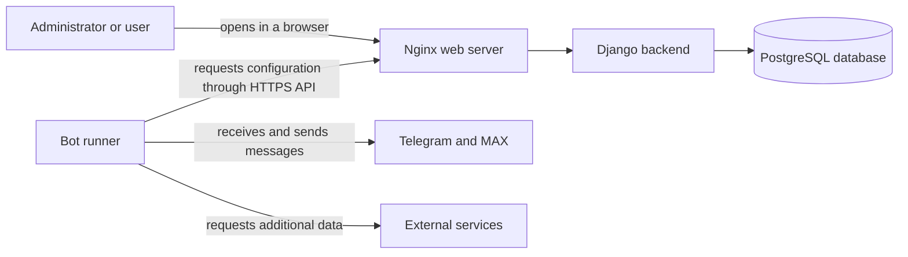

# Architecture

BotMesh consists of two main applications: the backend and the runner.

The **backend** is where bots are configured. It stores settings in PostgreSQL and provides the dashboard and API.

The **runner** is the process that actually starts the bots. It receives configuration from the backend, loads the required plugins and services, and connects to Telegram, MAX, or external services.

The backend and runner can run on the same machine or on separate servers.

## How the components communicate



In a typical request:

1. An administrator opens the dashboard through Nginx.
2. Django reads or updates the bot configuration in PostgreSQL.
3. The runner requests its assigned bots from the backend API.
4. The runner starts enabled bots and connects them to the selected messenger.
5. Plugins may use external services, for example an employee directory.

## Backend responsibilities

The backend stores:

- bots and their messenger settings;
- available and installed plugins;
- services used by plugins;
- actions that connect commands or events to plugin handlers;
- users and their access to bots;
- registered runners and their API keys.

The backend does not connect directly to Telegram or MAX and does not execute plugin code.

## Runner responsibilities

The runner contains the executable Python code for adapters, plugins, and services. It:

- authenticates with the backend using its runner API key;
- reports which plugins and services it supports;
- downloads configuration for bots assigned to it;
- starts and stops bot instances;
- handles messenger updates;
- calls external services when a plugin needs them.

Messenger tokens and external-service credentials should remain on the runner server whenever possible.

## Contract validation

The backend stores a description of the configuration expected by each plugin and service. The runner creates the same description from its Python models when it starts.

The runner sends these descriptions to the backend before starting any bots. If the backend and runner expect different fields or versions, startup stops with an error. This prevents an older runner from silently using configuration created for newer code.

For this reason, the backend and runner should normally use the same release tag or Git commit.

## Running on separate servers

The backend server normally contains:

- PostgreSQL;
- Django with Gunicorn;
- Nginx.

The runner server only needs the runner application and its local secrets. It does not need direct access to the backend database or filesystem.

The only required connection between the servers is the backend HTTPS API:

```text
Runner server  ── HTTPS API ──>  Backend server
```

Each runner has its own API key. Each bot also receives a separate backend-generated key for bot-specific API requests.

## Recommended update order

When updating a distributed installation:

1. Check out the same release or Git commit on both servers.
2. Update the backend first.
3. Apply Django migrations.
4. Run `sync_builtin_catalog`.
5. Confirm that the backend is working.
6. Update and restart the runner.
7. Check runner logs for successful contract validation and heartbeat requests.

Updating in this order ensures that the backend understands the configuration expected by the new runner before it connects.
